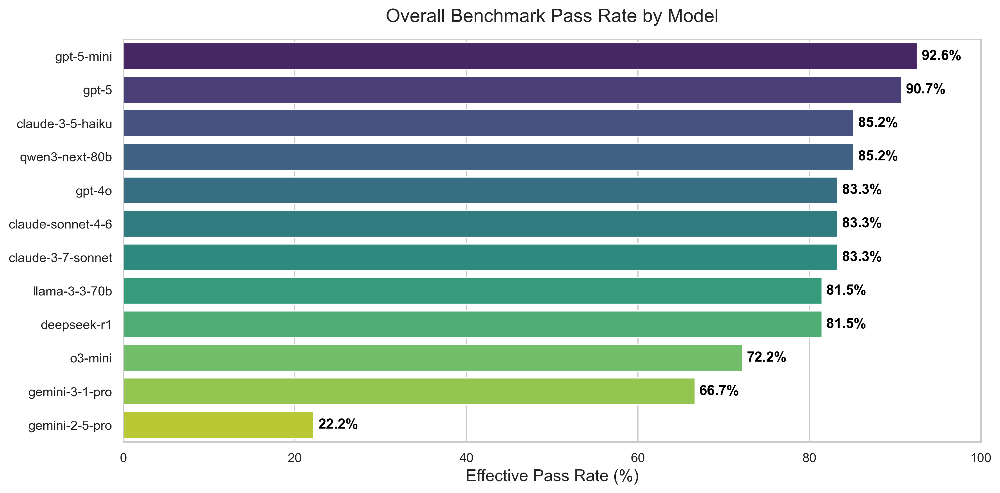

# Embodied LLM Robustness Benchmark

A Python evaluation harness for probing model failures in visual reasoning, spatial and tool-use tasks, and safety-oriented action scenarios. It keeps prompts, expected answers, model responses, and pass/fail decisions together in inspectable JSON reports.

**Python · OpenAI / Anthropic clients · OpenRouter · Pillow · JSON reports**



The chart above reflects an archived experiment, not a current model leaderboard. Some tasks use text proxies for visual or embodied scenarios; the harness does not operate a physical robot or reproduce every original benchmark protocol.

## Evaluation areas

| Area | Implementation |
| --- | --- |
| Visual reasoning and perception | [`test_whoops.py`](test_whoops.py), [`test_blindtest.py`](test_blindtest.py), [`test_spatial_relations.py`](test_spatial_relations.py) |
| Spatial reasoning and tool use | [`test_spatialvlm_and_embodied.py`](test_spatialvlm_and_embodied.py) |
| Safety and autonomy scenarios | [`test_safety_autonomy.py`](test_safety_autonomy.py) |
| Cross-model comparison | [`run_openrouter_comparison.py`](run_openrouter_comparison.py) |
| Provider configuration | [`config.py`](config.py) |

## Run locally

Use Python 3.11 or later. A live evaluation sends prompts to the selected model providers and incurs their API charges. Recorded JSON reports can be inspected without making requests.

```sh
python3.11 -m venv .venv
source .venv/bin/activate
pip install -r requirements.txt
# Configure credentials in your shell or a local, gitignored .env file.
export OPENAI_API_KEY=YOUR_KEY
export ANTHROPIC_API_KEY=YOUR_KEY
python run_all_tests.py --topic 1 --output results/local_run.json
```

Choose model IDs and provider routing in `config.py` before running. The full suite uses `python run_all_tests.py`; the comparison script uses `OPENROUTER_API_KEY`. Model availability and pricing are controlled by the providers and may differ from the archived run.

## Inspect the evidence

- [`results/`](results): archived individual responses and comparison reports.
- [Comparison notes](README_OPENROUTER_COMPARISON.md): experiment-specific setup.
- [Paper and protocol notes](README_PAPER_RESULTS.md): research context and distinctions from the original studies.
- [`generate_visualizations.py`](generate_visualizations.py): plotting utility; inspect its configured input file before use.

## Interpretation

Pass rates depend on the selected prompts, scoring rules, model versions, provider behavior, and failures during requests. A small fixed prompt set cannot establish general model safety or embodied capability. Inspect raw responses and scoring logic before comparing models; repeated runs and human review are appropriate before drawing broader conclusions.

Research references and contributor/group attribution are retained in the accompanying experiment documents and source files.
